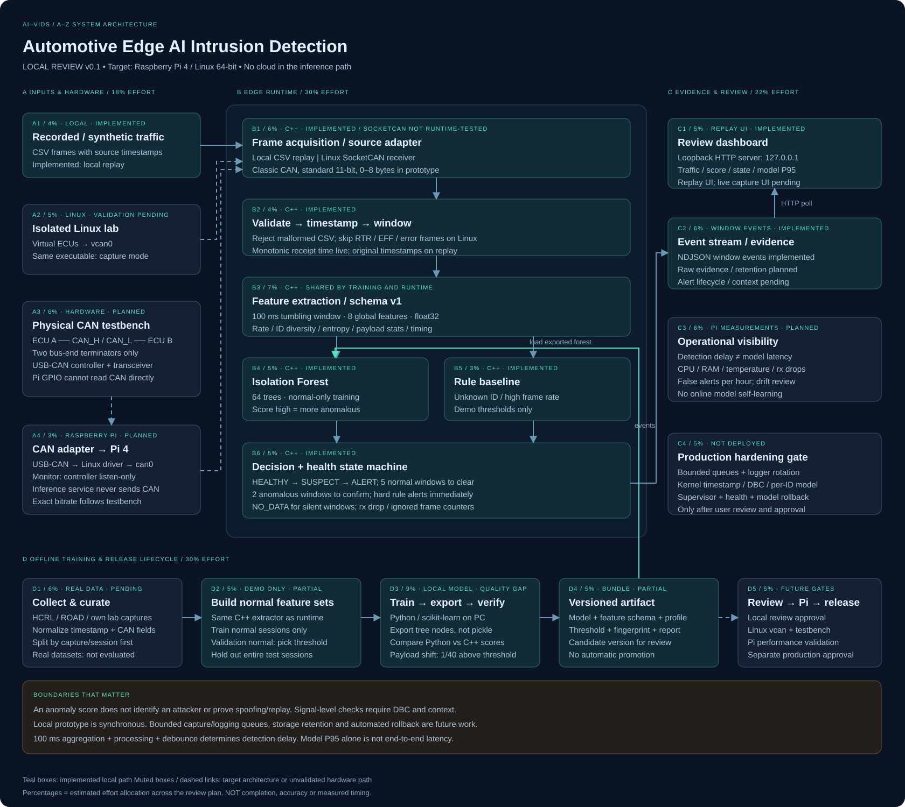

# AI-VIDS — bản local để review

Hệ thống phát hiện bất thường trên CAN bằng Edge AI, thiết kế đích Raspberry Pi 4. Bản này **chỉ triển khai local PC** theo yêu cầu của bạn; chưa kết nối Pi, CAN bus thật hay production.

## Xem ngay

- Dashboard local: **http://127.0.0.1:8765** khi local server đang chạy.
- [Sơ đồ tổng thể SVG](docs/architecture.svg) — mở bằng trình duyệt, zoom được, không phụ thuộc mạng.
- [Kiến trúc A–Z](docs/ARCHITECTURE.vi.md) — hardware, phần mềm, dữ liệu, AI, vận hành, kiểm thử và roadmap.
- [Bảng task tương tác](docs/TASK_REVIEW.html) — 38 task, 19 block arch; bấm block để lọc task, đọc ý nghĩa/outcome/tiêu chí review.
- [Task breakdown dạng Markdown](docs/TASK_BREAKDOWN.vi.md) — công sức ước lượng tổng 100%, trạng thái và dependencies.
- [Hướng dẫn chạy local](docs/LOCAL_REVIEW.vi.md).
- [Hướng dẫn chuyển sang Raspberry Pi](docs/DEPLOY_RASPBERRY_PI.vi.md) — replay → vcan → CAN testbench, chưa thực thi trên Pi.
- [Bắt đầu trên Ubuntu VMware](docs/UBUNTU_VM_FIRST_RUN.vi.md) — build/replay → vcan, mapping task và log cần review; chưa kiểm chứng ARM64/Pi.
- [Kết quả kiểm chứng](docs/VALIDATION.vi.md).



## Chạy lại trên Windows

```powershell
cd automotive-edge-ai-ids
powershell -ExecutionPolicy Bypass -File .\start-local.ps1
```

Mở http://127.0.0.1:8765, chọn **Chạy demo → Chạy kịch bản**. Server chỉ bind loopback. Không cần cloud, CAN HAT hoặc Pi để xem bản review này.

Build/train lại và chạy kiểm thử:

```powershell
.\.venv\Scripts\python.exe tools/prepare.py
.\.venv\Scripts\python.exe -m unittest discover -s tests -v
```

Trên Linux development PC, có thể dùng `python3 -m venv .venv`, cài requirements, chạy cùng các script bằng `.venv/bin/python`. C++ build ưu tiên `g++` / `clang++`; Windows local dùng Zig compiler nằm trong virtualenv nếu chưa có compiler.

## Đã làm được

- Executable **C++17 thật** đọc frame CSV, chia cửa sổ 100 ms và trích 8 đặc trưng.
- Train Isolation Forest bằng scikit-learn trên phiên dữ liệu normal mô phỏng riêng biệt.
- Export cây sang artifact văn bản; C++ inference trực tiếp, không gọi Python.
- Kiểm tra parity score C++ so với scikit-learn trên validation, normal test và demo.
- Rule baseline, state machine, trạng thái NO_DATA, NDJSON events và dashboard local.
- Có source nhận SocketCAN cho Linux; chưa chạy kiểm thử nhánh này trên kernel Linux.

## Phạm vi còn lại

Chưa train bằng HCRL/ROAD, chưa giải mã DBC, chưa có bộ nhận diện spoofing/replay theo signal, chưa đo trên Raspberry Pi. Các queue, lưu evidence có retention, cập nhật model/rollback tự động và production hardening được thiết kế trong tài liệu, chưa triển khai. Runtime hiện tại dùng một luồng xử lý đồng bộ.

Không dùng accuracy trên dữ liệu tổng hợp để kết luận khả năng bảo vệ xe thật. `models/manifest.json` ghi rõ nguồn dữ liệu, phiên bản thư viện và fingerprint của artifact.

Phát hiện còn yếu: payload shift trong demo chỉ có 1/40 window vượt ngưỡng ML và chưa tạo confirmed ALERT. Flooding/ID lạ được rule bắt. Đây là bản để review kiến trúc và pipeline; xem bảng kết quả trong [validation report](docs/VALIDATION.vi.md) trước khi chốt bước phát triển tiếp.

## Source layout

```text
src/main.cpp                   C++ features / inference / rules / CSV replay / SocketCAN
CMakeLists.txt                 Build bằng CMake trên môi trường có compiler
tools/prepare.py               Build, tạo dữ liệu, train, export, so khớp score
tools/serve.py                 Local HTTP UI và điều khiển replay
tools/draw_architecture.py     Nguồn sinh sơ đồ SVG
ui/index.html                 Giao diện review, không dùng CDN
tests/test_pipeline.py        Kiểm thử pipeline và edge cases
docs/ARCHITECTURE.vi.md        Thiết kế đầy đủ cùng sơ đồ Mermaid
docs/LOCAL_REVIEW.vi.md        Checklist review và lệnh chạy
docs/architecture.svg         Sơ đồ tổng thể
models/manifest.json          Metadata model demo
models/demo.forest            Artifact được tạo bởi prepare.py
data/*.csv                    Các phiên dữ liệu tổng hợp được sinh local
runtime/events.ndjson         Các window event của lần demo gần nhất
runtime/validation.json       Kết quả train/export/parity
```

Tên repo đề xuất: `automotive-edge-ai-ids`. Chưa khởi tạo remote hay publish bất kỳ nội dung nào.
# edge_ai
