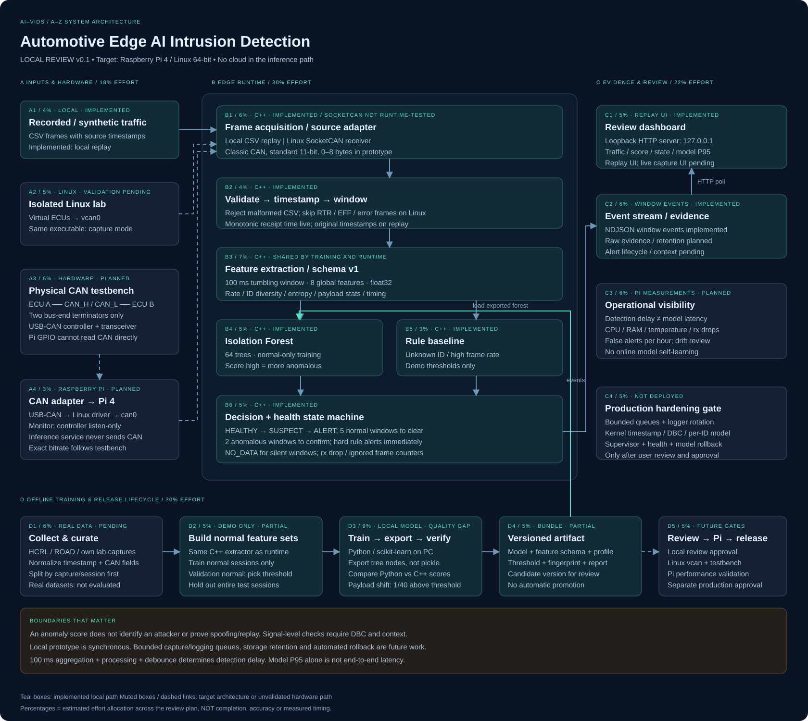
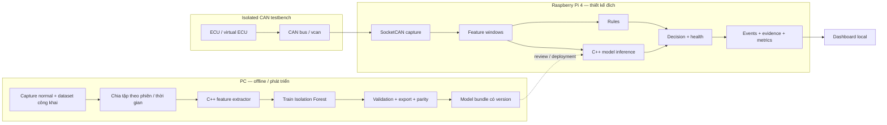
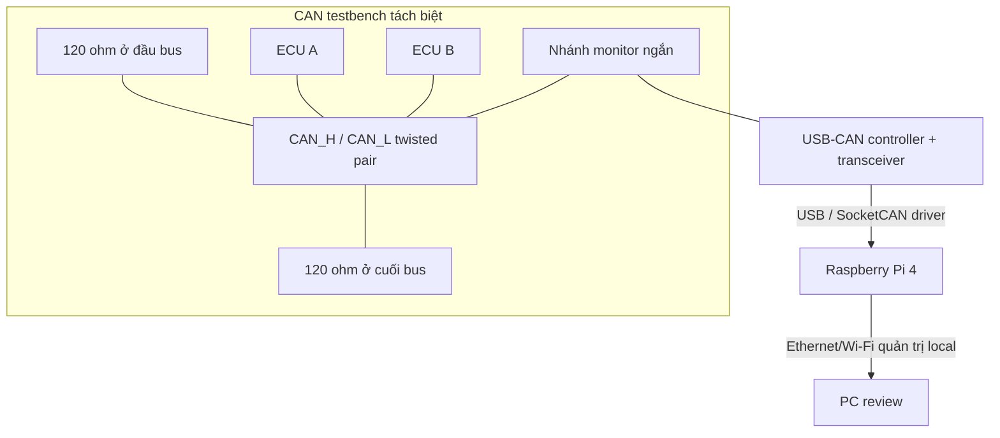
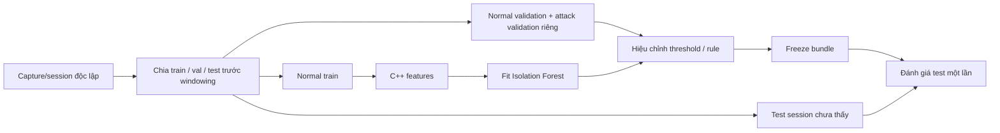
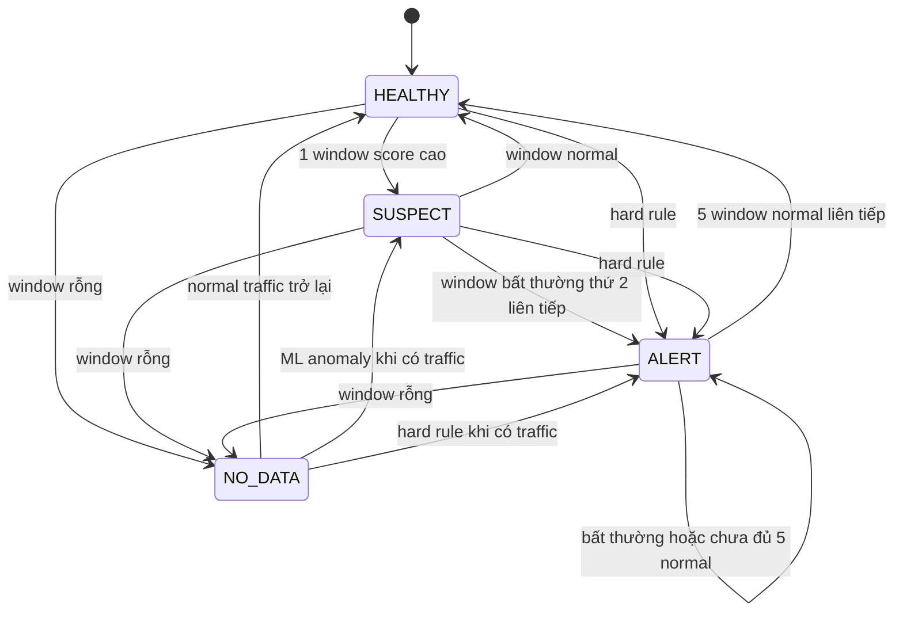
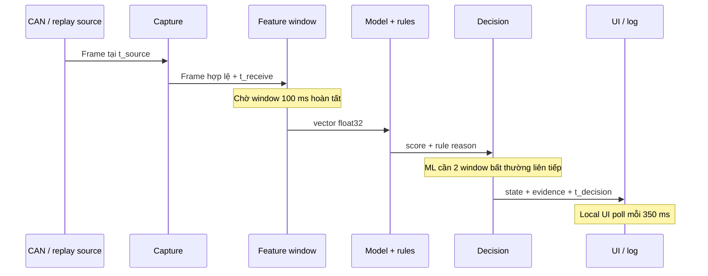
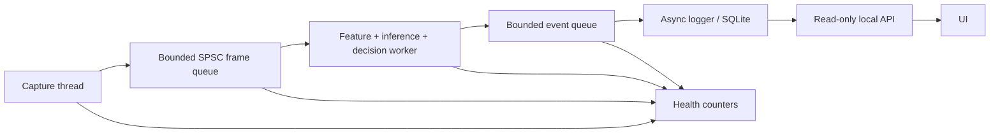
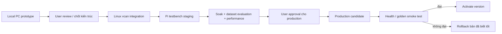

# AI-VIDS: kiến trúc từ A–Z

Trạng thái: **local prototype để review**, cập nhật ngày 29/10/2026. Thiết bị đích là Raspberry Pi 4, Linux 64-bit. Việc đưa lên Pi và production cần được bạn chốt ở bước sau.

## A. Mục tiêu và ranh giới

AI-VIDS quan sát CAN traffic, phát hiện cửa sổ dữ liệu khác với normal và xuất cảnh báo có bằng chứng. Runtime đích chạy trực tiếp trên edge; PC phục vụ train, phân tích và phát hành artifact. Cloud không nằm trong đường inference.

MVP là passive IDS. Trong bản runtime, không có lời gọi gửi CAN. Tuy nhiên, controller CAN ở normal mode vẫn có thể ACK hoặc phát error flag dù ứng dụng chỉ đọc; khi cần giám sát thụ động ở tầng điện phải cấu hình **controller listen-only** trên adapter hỗ trợ tính năng này. Một monitor listen-only không thay thế node ACK trên bus thử nghiệm. SocketCAN cung cấp CAN qua network interface và socket API của Linux: [Linux Kernel documentation](https://docs.kernel.org/networking/can.html).

Phạm vi prototype: CAN Classic, data frame standard 11-bit, payload 0–8 byte. Extended ID, RTR và error frame không đi vào feature pipeline; Linux receiver đếm chúng vào `ignored_frames`. CAN FD chưa được hỗ trợ. Production cần tách từng loại và báo health chi tiết hơn.

**Không cam kết** chứng nhận automotive, hard real-time, xác định ECU gửi hay phát hiện mọi kiểu replay/spoofing. Không tự động chặn frame hay gửi lệnh điều khiển ECU.

## B. Sơ đồ tổng thể



Màu teal là phần local đã có implementation. Khối xám và đường đứt là phần thiết kế đích hoặc phần chưa được kiểm chứng trên phần cứng.



## C. Phần cứng và kết nối

| Thành phần | Vai trò | Lựa chọn cho MVP |
|---|---|---|
| Raspberry Pi 4 hiện có | Edge inference | Linux 64-bit; benchmark đúng RAM/OS thực tế của bạn |
| Nguồn ổn định, tản nhiệt | Tránh throttle/reset làm sai benchmark | Theo thông số nguồn và phụ kiện Pi đang dùng |
| USB-CAN | Controller + transceiver, driver SocketCAN | Ưu tiên adapter có driver Linux và listen-only đã được kiểm chứng |
| CAN HAT | Phương án thay USB-CAN | Cần xác nhận controller, oscillator, driver, overlay, mức điện áp |
| CAN testbench | Cung cấp traffic và node ACK | Ít nhất các ECU/node hoạt động phù hợp với topology |
| PC | Train và review | Windows hiện tại; Linux cần cho vcan/SocketCAN runtime tests |
| microSD/SSD | OS, model và log | Đo dung lượng và write load; log thô dài hạn ưu tiên lưu trữ phù hợp |

Chưa cần mua accelerator AI cho cấu hình Isolation Forest này; quyết định phần cứng bổ sung sau khi đo trên Pi. Đây là lựa chọn thiết kế cho MVP, chưa phải kết luận benchmark.



Hai điện trở termination nằm ở hai đầu vật lý của bus; không tự thêm termination thứ ba ở monitor. Chọn phương án common reference hoặc cách ly điện đúng theo adapter/testbench. Pi GPIO không đọc trực tiếp CAN_H/CAN_L. Bitrate và kiểu frame phải khớp mạng lab; tài liệu không mặc định mọi xe đều dùng 500 kbit/s. Truy cập qua OBD có thể bị gateway giới hạn segment nhìn thấy.

## D. Hai chế độ nguồn vào

1. **Local review hiện tại:** CSV tổng hợp → replay C++ native trên Windows. Dữ liệu và model tạo trên PC; không có kết nối tới Pi.
2. **Linux lab sau review:** vcan0 hoặc can0 → SocketCAN. Cùng executable, cùng feature/model. Nhánh source có implementation, chưa runtime-test trong môi trường local Windows này.

`vcan` cho phép kiểm thử API và logic, nhưng không mô phỏng arbitration, bit timing, lỗi điện hay bus saturation. Không suy ra năng lực xử lý bus thật chỉ từ tốc độ replay CSV.

## E. Module và trách nhiệm

| Module | Input → output | Hiện trạng |
|---|---|---|
| Source adapter | CSV / SocketCAN → Frame | CSV đã chạy; SocketCAN chờ Linux test |
| Frame validation | timestamp + ID + DLC + payload → frame hợp lệ | Có, giới hạn CAN v1 |
| Feature engine | frames → window vector 8 chiều | Có trong C++ |
| Model loader/inference | artifact + vector → anomaly score | Có; kiểm schema và topology cây |
| Rules | window + whitelist → lý do nghi ngờ | Có unknown ID và high rate cho demo |
| Decision engine | score + rule + history → state | Có debounce, hysteresis theo số window |
| Event output | kết quả mỗi window → NDJSON stdout | Có |
| Local review server | NDJSON subprocess → API state | Có; chỉ 127.0.0.1 |
| Dashboard | API → biểu đồ/trạng thái | Có; dữ liệu đo từ C++ |
| Health/metrics | drop/ignored/inference timing → event | Một phần; thiếu resource metrics trên Pi |
| Evidence store | raw pre/post-event + metadata | Thiết kế; chưa triển khai |
| Model manager | version, activate, rollback | Có manifest/fingerprint; chưa tự activate/rollback |

## F. Dữ liệu và clock contract

Frame CSV v1:

```csv
timestamp_us,can_id_hex,dlc,data_hex,label
0,100,8,5058606870788088,normal
1000,200,8,5159616971798189,normal
```

- Timestamp là số nguyên microsecond, tăng không giảm trong từng capture. Reset clock phải tách phiên. Khoảng nhảy trên một giờ sau frame trước bị từ chối để tránh sinh quá nhiều window trống.
- ID là hex không kèm flag, thuộc 0x000–0x7FF. DLC phải khớp số byte payload.
- `label` chỉ là ground truth cho công cụ đánh giá; C++ không dùng label làm đặc trưng hoặc ra quyết định.
- Linux live hiện dùng **steady/monotonic software receipt time** ở user space. Timing này chịu ảnh hưởng scheduling. Timestamp phần cứng/kernel và quy tắc ánh xạ clock là hạng mục nâng cấp trước benchmark timing có độ tin cậy cao.
- Production lưu cả `source_timestamp`, `monotonic_receive_timestamp`, `decision_timestamp` và `clock_domain`. Không trừ hai timestamp thuộc hai miền clock khác nhau.
- Không giả định tất cả payload là RPM/speed khi chưa có DBC đúng xe và đúng version. DBC phải khai báo endian, signedness, factor, offset, counter/checksum.

## G. Cửa sổ và feature schema v1

MVP dùng **tumbling window 100 ms**, không overlap. Window `[start, start + 100000 µs)` neo theo bội 100000 của timestamp. Frame ở biên thuộc window mới. Chỉ score window hoàn chỉnh; window cuối chưa đủ thời gian ở EOF bị bỏ. Gap giữa frame tạo window rỗng; live mode có timer tick nên vẫn thấy NO_DATA khi im lặng.

| Thứ tự | Feature | Định nghĩa/đơn vị |
|---|---|---|
| 0 | fps | Số frame trong 100 ms × 10, frames/s |
| 1 | unique_ids | Số CAN ID khác nhau trong window |
| 2 | id_entropy | `-Σ p(id) log2 p(id)`, bit |
| 3 | max_id_share | Tỷ trọng ID xuất hiện nhiều nhất, 0–1 |
| 4 | byte_mean | Trung bình byte payload thực có trong window, 0–255 |
| 5 | byte_std | Population standard deviation của byte payload |
| 6 | bit_flip_mean | Trung bình tỷ lệ bit khác giữa hai frame liên tiếp cùng ID và cùng DLC, 0–1 |
| 7 | same_id_iat_ms | Trung bình inter-arrival time cùng ID trong window, ms |

Các accumulator và frame trước của mỗi ID reset tại mỗi window. Thiếu byte hoặc thiếu cặp so sánh thì feature tương ứng bằng 0. Vector score được cast float32 giống input của sklearn. Không có scaler trong schema v1; không tự thêm scaler khi deploy.

Unknown ID là rule riêng dựa vào whitelist trong model profile, không phải nhãn tấn công. Phiên bản demo có whitelist 0x100/0x200/0x300 và rate rule >1800 frames/s cho dữ liệu tổng hợp; các giá trị này **không dùng nguyên xi trên xe thật**.

V2 nên dùng rolling window theo từng ID, period error, counter continuity, byte entropy, tín hiệu decoded và quan hệ signal. Feature toàn cục có thể làm loãng thay đổi của một ID ít xuất hiện. Với sliding window 100 ms/hop 20 ms, phải benchmark lại tải CPU và quy định purge gap khi chia dữ liệu để tránh overlap giữa các tập.

## H. Mô hình AI và artifact

MVP: 64 Isolation Trees, max_samples 128, max_features 1.0; train normal-only bằng scikit-learn trên PC. Không tự train lại online trên traffic đang nghi ngờ.

Inference C++ tính path length tới leaf, cộng correction theo số mẫu trong leaf rồi chuẩn hóa. Quy ước hệ thống: `anomaly_score = -sklearn.score_samples(x)`, score cao hơn thì bất thường hơn. Chọn threshold bằng percentile 99.5% trên normal validation riêng. Không nhầm với `decision_function` hay `offset_`: [IsolationForest documentation](https://scikit-learn.org/stable/modules/generated/sklearn.ensemble.IsolationForest.html).

Artifact `.forest` chứa:

```text
magic/schema, feature_count, tree_count, max_samples, threshold, window_us, whitelist_count
whitelist IDs
tree node_count
left_child right_child feature_index split_threshold leaf_sample_count
... các node / tree tiếp theo
```

`manifest.json` có thứ tự feature, phiên bản thư viện, cách chọn threshold, số window train/validation/test, score parity error, SHA-256 artifact và giới hạn kiểm chứng. Hash giúp nhận biết file thay đổi; **không thay thế chữ ký xác thực**. Model v1 chỉ hỗ trợ cấu hình export đã kiểm parity, không tự tương thích mọi biến thể Isolation Forest.

Release bundle đích bổ sung `model_version`, git commit, training-data fingerprint, DBC/profile version, golden vectors, evaluation report, build architecture và chữ ký nếu cần phân phối qua kênh không tin cậy. Runtime hiện chưa tự kiểm chữ ký/hash lúc load.

## I. Dataset, chia tập và chống leakage



- HCRL Car-Hacking có normal, DoS, fuzzing, RPM/gear spoofing; nguồn chính thức mô tả trường timestamp, ID, DLC, payload, flag: [HCRL](https://ocslab.hksecurity.net/Datasets/car-hacking-dataset).
- ROAD cung cấp capture normal và các mức tấn công, có metadata và một phần signal-translated data: [Dataset record](https://zenodo.org/records/10462796). Khác biệt về realism và phạm vi dataset được tác giả phân tích tại [ORNL](https://www.ornl.gov/publication/comprehensive-guide-can-ids-data-and-introduction-road-dataset).
- Không gộp CSV rồi random split từng frame. Cần split theo capture/phiên và thời gian; giữ các đoạn overlap hoặc cùng attack event trong cùng tập.
- Không train với timestamp tuyệt đối, tên file, label, cột “attack flag” hay trường chỉ có sau quá trình gán nhãn.
- Dữ liệu từ xe khác phải báo riêng domain shift. Whitelist/profile/DBC và threshold có thể phụ thuộc từng xe, không mặc định model một xe dùng được cho mọi xe.
- Model demo hiện chỉ được train bằng dữ liệu tổng hợp sinh local. Các bộ dữ liệu thực chưa tải vào hay đánh giá. Script prepare hiện là pipeline demo; adapter HCRL/ROAD là công việc tiếp theo.

## J. Quyết định, nhãn cảnh báo và khả năng nhận diện

| Dấu hiệu | Thành phần | Output đúng mức |
|---|---|---|
| Rate tăng mạnh | Rate/IAT rule + model | `possible_flooding` |
| ID không thuộc profile | Whitelist rule | `unknown_id` |
| Phân bố payload/timing thay đổi | Model | `ml_anomaly` |
| Counter sai, chu kỳ và signal không nhất quán | DBC rules / temporal model, kế hoạch | `possible_spoofing` hoặc `possible_replay` kèm lý do |
| Không nhận frame trong window | Health monitor | `NO_DATA`; không gán nhãn attack |

CAN ID không xác thực danh tính ECU gửi. Chuỗi replay hợp lệ về timing/counter hoặc payload spoofing hợp lý có thể không phân biệt được chỉ từ CAN quan sát được. Anomaly score không phải xác suất tấn công và Isolation Forest không phải model phân loại DoS/fuzzing/spoofing/replay.



`reason` mô tả window hiện tại; `state` có nhớ lịch sử. Vì vậy ALERT có thể còn giữ 4 window với reason `normal`. Production nên giữ riêng `alarm_state` và `sensor_health` để mất traffic không xóa lịch sử alarm đang mở; MVP hiện có một state chung và ghi lại chuỗi event để truy nguyên.

## K. Latency từ đầu tới cuối



`Detection delay = t_first_confirmed_alert - t_attack_onset`. Cần lấy ground truth attack onset từ test harness/metadata đồng bộ. Độ trễ gồm pha trong window, xử lý, hàng đợi và debounce; UI có độ trễ poll riêng. Với rule xảy ra ngay trong window, bản hiện tại vẫn chờ kết thúc window để quyết định. Không tuyên bố inference 1 ms nghĩa là phát hiện trong 1 ms.

Replay realtime hiện phát kết quả dựa timestamp mô phỏng, không dùng clock wall để tính feature. Replay nhanh để benchmark tính toán phải được báo riêng với replay 1× và live CAN.

## L. Concurrency, backpressure và failure handling

Bản local hiện tại là **một luồng C++ đồng bộ** cho capture → features → model → stdout. Đây là cách kiểm chứng logic trước. Chưa có ring buffer ở runtime này; việc ghi log chậm có thể ảnh hưởng nhận frame ở nhánh live.

Kiến trúc đích sau review:



- Capture không chờ UI, cloud hay disk. Queue có giới hạn xác định từ measured peak × allowable backlog, không tự tăng vô hạn.
- Khi full, chọn policy explicit (ví dụ drop-new) và tăng counter. Window có dữ liệu rơi phải gắn `data_quality=degraded`, không báo “normal đáng tin cậy”. Tách kernel/socket drop và application queue drop.
- Linux prototype bật `SO_RXQ_OVFL` và công bố counter socket-drop khi nhận ancillary message; counter có thể chỉ cập nhật khi có packet tiếp theo. Chưa đo drop ở phần cứng adapter/driver hay application queue.
- Disconnect/interface down: prototype fail với exit code khác 0; supervisor đích khởi động lại có rate limit. Mất traffic có thể do lab im lặng, đứt cáp, lỗi capture hoặc bus, không tự kết luận nguyên nhân.
- Model sai schema/corrupt: fail-closed với exit nonzero, không trả trạng thái “healthy”. Mode rules-only phải được cấu hình và hiển thị rõ nếu thêm sau.
- Disk full: giữ health và cảnh báo, giảm evidence theo policy, không treo capture. Chưa có disk-full recovery trong MVP.

## M. Evidence, lưu trữ và API

Event hiện có: `t_ms` (window start), `window_end_ms`, `frames`, `fps`, `score`, `threshold`, `state`, `reason`, `unknown_frames`, `inference_us`, `rx_drops`, `ignored_frames`. Mỗi event tương ứng một window, không phải một attack event độc lập. Trong realtime replay, kết quả chỉ được phát sau thời điểm kết thúc window, không phát ngay tại timestamp bắt đầu window.

Thiết kế event đích bổ sung UUID, source interface, model/profile version, window start/end, ID đóng góp, triggered rules, data quality, monotonic/UTC clock metadata và references tới raw evidence. Alert event nên có opened/updated/closed để tránh đếm 40 window ALERT thành 40 cuộc tấn công.

Lưu trữ đích: raw pre/post-event ring buffer → compressed chunk; event index SQLite WAL; rotation theo tuổi và dung lượng. Ví dụ chính sách 7 ngày/1 GB phải được chọn theo thẻ nhớ và nhu cầu thực, không hardcode làm tiêu chuẩn. Bản local ghi NDJSON của lần chạy gần nhất và giữ tối đa 600 window trong API memory.

Local API có `GET /api/state`, `GET /api/validation`, `POST /api/replay`. Server Python hiện là review tool, không phải production web server. Dashboard mặc định ở localhost; nếu xem từ PC tới Pi sau này, ưu tiên SSH tunnel hoặc bổ sung authentication/TLS trước khi expose mạng.

## N. Build, deploy và rollback



Hiện mới ở A. Không có script tự SSH, cấu hình mạng Pi, cài system service hay publish production trong bộ local này.

Thiết kế deploy đích: build native AArch64 hoặc cross-build toolchain xác định; model read-only ở thư mục versioned; service account quyền tối thiểu; interface được cấu hình riêng bằng quyền quản trị. `systemd` quản lý restart/health khi đã kiểm chứng. Không cho inference process `CAP_NET_ADMIN` chỉ để tự thay bitrate. Ràng buộc thêm AF_CAN/AF_UNIX/AF_INET nếu có API, filesystem write path và resource limits theo OS thực tế.

Release: verify bundle, score golden vectors, chạy shadow test, đổi active version atomically, restart, kiểm health; giữ previous version. Rollback áp dụng cả model + feature schema + profile + runtime tương thích. Chi tiết systemd/installer chỉ chốt sau khi biết OS và bạn đồng ý bước Pi.

## O. Validation và tiêu chí nghiệm thu

| Nhóm | Phép đo | Mục tiêu ban đầu / trạng thái |
|---|---|---|
| Export fidelity | Max abs score error Python/C++ | ≤1e-7 trên test vectors; kết quả local trong validation report |
| Feature correctness | Golden vector tính tay, boundary và silence | Kiểm bằng unittest gọi executable |
| Input robustness | DLC sai, timestamp đảo, model sai | Reject/fail rõ ràng |
| Throughput | Capture nhận và xử lý liên tục ≥1000 frames/s | Mục tiêu thử nghiệm, chưa đo trên Pi |
| Model latency | P95/P99 model-only per window | P95 <20 ms là mục tiêu ban đầu, chưa đo trên Pi |
| Detection delay | Từ onset đến first confirmed alert | Báo theo kịch bản, bao gồm window/debounce |
| Detection quality | Precision/recall/F1, PR-AUC nếu phù hợp | Theo window và event; chưa có kết quả dataset thực |
| False alarms | ML window FPR + alert events/giờ | Tách riêng; normal holdout đủ dài |
| Resource | CPU/core, RSS, nhiệt độ, throttling, disk write | Đo trên Pi đúng cấu hình |
| Reliability | Drop counters, disconnect, disk full, restart, silence | Linux lab và soak test trước production |

Đánh giá detection cần confidence intervals, thời lượng normal, số attack event và các scenario fail. Mỗi label/kịch bản có confusion matrix riêng. Không dùng accuracy đơn lẻ trên dữ liệu mất cân bằng. Local synthetic smoke test chỉ chứng minh tính đúng của pipeline, không chứng minh khả năng bảo vệ xe.

## P. Roadmap 8 tuần và đầu ra

| Tuần | Trọng tâm | Điều kiện kết thúc |
|---|---|---|
| 1 | Chốt kiến trúc, Linux vcan, CAN sniffer | Capture/parser/clock kiểm chứng |
| 2 | Capture normal, profile, feature v1/v2 | Data contract và golden vectors |
| 3 | Rule baseline, health, logging | Fault cases và event semantics rõ |
| 4 | Dataset adapters, Isolation Forest | Split theo session; validation/test report |
| 5 | Pi inference và concurrency | Parity đạt, không drop ở tải đã chốt |
| 6 | Dashboard, evidence, model lifecycle | Review được một alert từ raw frame tới quyết định |
| 7 | ECU lab scenarios, cross-session tests | Recall/false alarm/delay theo scenario |
| 8 | Soak, CPU/RAM/nhiệt, tài liệu demo | Bundle có version và báo cáo giới hạn |

Đầu ra portfolio: sơ đồ, source C++/Python, data provenance, model manifest, benchmark đúng phần cứng, fault-injection report và video demo local/lab. Chỉ gọi là đã triển khai trên Pi khi đã có log chạy và benchmark trên chính Pi.

## Q. Các quyết định bạn cần review

1. Giữ lõi C++17 + Isolation Forest cho MVP; deep learning là nhánh so sánh sau.
2. Xác nhận dùng Linux 64-bit trên Pi và chọn USB-CAN/CAN HAT.
3. Chốt dataset/capture của xe đích, có/không DBC, phạm vi CAN Classic/FD.
4. Chọn false-alarm budget và detection-delay target trước tuning threshold.
5. Chấp thuận bản local trước khi chuyển sang Pi staging. Production là một bước phê duyệt riêng theo yêu cầu của bạn.
