# Đưa AI-VIDS lên Raspberry Pi 4 để kiểm chứng

Cập nhật 31/10/2026. Đây là hướng dẫn và gói staging đã chuẩn bị trên PC. Chưa kết nối hay thay đổi Pi; chưa triển khai production.

## 1. Cách phân chia công việc

```mermaid
flowchart LR
  PC[PC: train + validate + export] --> B[Source C++ + model + profile + reference scores]
  B --> BUILD[Pi Linux ARM64: native build]
  BUILD --> REPLAY[CSV replay + score parity]
  REPLAY --> VCAN[vcan0: kiểm tra SocketCAN]
  VCAN --> LAB[can0: isolated CAN testbench]
  LAB --> REVIEW[Benchmark + review kết quả]
  REVIEW --> PROD[Production: quyết định riêng sau review]
```



Pi chạy executable C++ và model `.forest`. Không copy `ai-vids.exe`, `.venv` Windows hay bộ compiler Zig sang Pi. Không cần numpy/scikit-learn để inference; Python 3 standard library chỉ phục vụ kiểm tra bundle và dashboard demo nếu dùng.

## 2. Kiểm tra Pi hiện có

Giả sử Raspberry Pi OS 64-bit hoặc Linux ARM64 tương đương có apt. Trên Pi:

```bash
uname -m
getconf LONG_BIT
cat /etc/os-release
```

Mong đợi `aarch64` và `64`. Nếu đang chạy OS 32-bit, cần đánh giá riêng trước khi theo cấu hình này; không tự ghi lại thẻ nhớ hiện tại. Có thể bật SSH trên OS đang dùng và truy cập bằng username do bạn tạo; không mặc định mọi Pi đều có user `pi`. Xem [Raspberry Pi configuration](https://www.raspberrypi.com/documentation/computers/configuration.html).

## 3. Copy gói review từ PC

Gói đã có ở `build/ai-vids-pi-review.tar.gz`. Thay `YOUR_USER` và `PI_IP` bằng tài khoản/IP thực tế.

PowerShell trên PC, ở thư mục project:

```powershell
scp .\build\ai-vids-pi-review.tar.gz YOUR_USER@PI_IP:~/
ssh YOUR_USER@PI_IP
```

Các lệnh tiếp theo chạy **trên Pi**, trong phiên SSH:

```bash
mkdir -p ~/ai-vids-review
tar -xzf ~/ai-vids-pi-review.tar.gz -C ~/ai-vids-review
cd ~/ai-vids-review
sudo apt update
sudo apt install -y build-essential cmake python3 can-utils iproute2
cmake -S . -B build -DCMAKE_BUILD_TYPE=Release
cmake --build build -j2
```

Gói chỉ gồm source, demo model/data, UI và metadata cần thiết. `pi-bundle.json` ghi SHA-256 từng file. Các hash dùng kiểm tra file copy có khớp, không thay chữ ký xác thực khi phát hành qua kênh không tin cậy.

## 4. Chạy AI trên Pi trước khi nối CAN

```bash
python3 tools/verify_pi_bundle.py
python3 -m unittest discover -s tests -v
./build/ai-vids replay data/demo.csv models/demo.forest --realtime
```

Kiểm tra bundle phải PASS, native score error ≤1e-7 trên 32 golden windows. Reference được lấy từ scorer local đã đối chiếu với sklearn ở bản local. Đây là kiểm tra chuyển nền tảng, không phải đánh giá khả năng nhận diện.

Replay sẽ phát 460 window event trong khoảng 46 giây. Quan sát `possible_flooding`, `unknown_id` và `NO_DATA`. `t_ms` là window start, `window_end_ms` là window end; không lấy window start làm thời điểm ra quyết định.

**Giới hạn model hiện tại:** dữ liệu tổng hợp, whitelist 0x100/0x200/0x300 và high-rate rule >1800 frames/s. Payload-shift demo chỉ 1/40 window vượt ngưỡng ML, chưa đủ confirmed ALERT. Không dùng model demo này làm model bảo vệ mạng CAN thật.

## 5. Kiểm thử SocketCAN bằng vcan0

Chưa cần CAN HAT/USB-CAN:

```bash
sudo modprobe vcan
sudo ip link add dev vcan0 type vcan
sudo ip link set dev vcan0 up
ip -details link show vcan0
./build/ai-vids capture vcan0 models/demo.forest
```

Nếu `vcan0` đã tồn tại, bỏ qua lệnh `ip link add`. Mở terminal SSH thứ hai trên Pi:

```bash
cansend vcan0 100#1122334455667788
cansend vcan0 666#1122334455667788
```

Frame 0x666 cần tạo dấu hiệu `unknown_id`; im lặng trở lại sẽ thấy `NO_DATA`. Các frame đơn lẻ trên đây chỉ kiểm tra đường nhận và rule, không đại diện normal traffic dùng để train. Lệnh phát chỉ dùng `vcan0` trong bước này. vcan không mô phỏng arbitration, lỗi điện và bus saturation. [SocketCAN documentation](https://docs.kernel.org/networking/can.html).

## 6. CAN phần cứng — sau khi vcan đạt

Cần adapter có **CAN controller + transceiver** và driver SocketCAN tương thích. USB-CAN và CAN HAT là hai phương án; chi tiết driver/overlay phụ thuộc đúng model adapter. Pi GPIO không nối trực tiếp CAN_H/CAN_L.

Kết nối lab: `ECUs → CAN_H/CAN_L → adapter → Pi`. Giữ đúng hai termination ở hai đầu bus, nguồn/reference hoặc cách ly theo adapter. Monitor không tự thêm termination thứ ba. Bước này dùng CAN testbench tách biệt.

Ví dụ dưới đây **chỉ áp dụng khi lab đã xác nhận bitrate 500000**, adapter có listen-only, driver đã tạo `can0`:

```bash
sudo ip link set dev can0 down
sudo ip link set dev can0 type can bitrate 500000 listen-only on
sudo ip link set dev can0 up
ip -details -statistics link show can0
```

Listen-only là cấu hình controller, không phải chỉ do ứng dụng không gọi send(). Nó không ACK cho các node khác; bus lab cần các node hoạt động đúng. Nếu adapter không hỗ trợ, không âm thầm đổi sang normal mode. Xem [controller modes](https://docs.kernel.org/networking/can.html).

Model/profile thực tế phải được tạo từ dữ liệu đại diện cho testbench. Sau khi có model đã kiểm chứng, lệnh runtime có dạng:

```bash
./build/ai-vids capture can0 models/lab-validated.forest
```

`lab-validated.forest` là artifact cần tạo ở giai đoạn train dữ liệu lab, chưa nằm trong gói demo. Runtime hiện hỗ trợ standard 11-bit Classic CAN; Extended ID/RTR/error frames bị bỏ khỏi feature và đếm ignored; chưa hỗ trợ CAN FD.

## 7. Xem dashboard chạy trên Pi từ PC

Dashboard hiện hỗ trợ **replay CSV**, chưa đọc trực tiếp event của tiến trình `capture can0`.

Trên Pi, tại thư mục project:

```bash
python3 tools/serve.py --port 8765
```

Mở PowerShell khác trên PC:

```powershell
ssh -N -L 8766:127.0.0.1:8765 YOUR_USER@PI_IP
```

Mở `http://127.0.0.1:8766`. Port local 8766 tránh nhầm với bản PC đang chạy ở 8765. Khi bấm replay trên UI này, C++ inference chạy trên Pi. Tab validation vẫn chứa báo cáo offline từ PC trong bundle; P95 hiển thị trong lượt replay mới là phép đo model-only trên Pi. Nó chưa phải full-pipeline/detection latency.

Muốn dashboard xem CAN live cần bổ sung source mode `capture`, quản lý subprocess và health, đọc NDJSON live vào API, đổi label UI và loại bỏ metadata replay cố định. Chưa thể chỉ chạy `capture` rồi mong UI hiện tại tự thấy traffic.

## 8. Benchmark trước khi chạy service dài hạn

Tối thiểu đo trên Pi đúng RAM/OS/adapter thực tế:

- Throughput nhận/xử lý và drop ở tải lab đã chọn.
- P95/P99 model, full processing latency và detection delay riêng.
- CPU, RSS, nhiệt độ, throttling và disk write.
- False alerts trên normal holdout; recall/delay theo kịch bản.
- Silence, interface down, restart và log failure.

Có thể dùng `top`, `ps`, `ip -s -d link show can0`; `vcgencmd measure_temp` và `vcgencmd get_throttled` nếu Raspberry Pi OS cung cấp công cụ đó.

Sau khi chạy thủ công đạt mới thêm systemd: user quyền tối thiểu, interface được cấu hình trước, model versioned read-only, restart có giới hạn và log retention. Runtime hiện đồng bộ, chưa có bounded capture/log queue, nên phải kiểm tra ảnh hưởng stdout/disk chậm trước khi chạy dài hạn. Không mặc định redirect NDJSON liên tục vào microSD không giới hạn.

Production là bước riêng sau khi bạn review kết quả trên Pi, dữ liệu/model thực và kế hoạch vận hành/rollback. Bộ gói này không có thao tác tự SSH, cài service, sửa networking hay deploy production.
