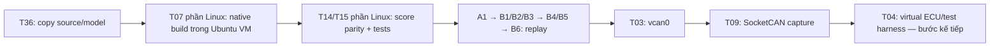

# Mốc Ubuntu trên VMware — làm gì trước, nghiệm thu bằng gì?

Đây là hướng dẫn cho bạn chạy trong Ubuntu guest. Bộ gói được chuẩn bị/kiểm integrity trên PC; chưa có kết quả chạy Ubuntu VM của bạn. Không triển khai Pi hay production trong bước này.

## Phạm vi mốc VM



| Bước VM | Task liên quan | Arch | Outcome/điều kiện đạt |
|---|---|---|---|
| Chuẩn bị Ubuntu và compiler | T07, phần Linux | A4 | Ghi OS/kernel/arch, có CMake/C++ compiler |
| Copy và build source | T36 + T07 phần Linux | D4 → A4 | Native executable `build/ai-vids` trong guest |
| Kiểm file và score | T14 + T15 phần Linux | B4/D4 | PASS 32 golden windows, error ≤1e-7 |
| Chạy tests | T01/T08/T11/T12/T16/T18 | A1/B1/B2/B3/B5/B6 | 12 tests đạt trên Ubuntu |
| Replay full pipeline | T02/T14/T16/T18 | A1 → B1…B6 | 460 window JSON, mô hình/rule chạy trong guest |
| SocketCAN smoke test | T03/T09 | A2 → B1…B6 | Nhận được frame từ vcan; 0x666 tạo reason unknown_id |
| UI replay, tùy chọn | T20 | C1 | UI mở trong guest; replay chạy bằng binary Ubuntu |
| Kịch bản có ground truth | T04, bước sau | A2 | Cần viết test harness sau khi smoke test đạt |

T07/T15 ban đầu có điều kiện đạt trên Pi ARM64. Kết quả x86_64 VM chỉ xác nhận phần Linux, chưa đóng hai task Pi đó. Cũng chưa đạt T25 benchmark Pi hoặc T37 Pi staging. Các số phần trăm trong WBS không tự trở thành % hoàn thành sau mốc VM.

## 1. Chuẩn bị Ubuntu guest

Nếu VM đã chạy Ubuntu, giữ môi trường hiện có, kiểm tra:

```bash
uname -m
uname -r
getconf LONG_BIT
cat /etc/os-release
```

Trên Windows host AMD64, guest thường trả `x86_64`/`64`, phù hợp cho bước này. Không yêu cầu ARM64 trong VM.

VMware Network Adapter có thể dùng NAT để guest truy cập Internet cài package. `vcan0` nằm trong kernel Ubuntu guest; không cần đổi sang Bridged chỉ để dùng vcan, và chưa cần USB-CAN passthrough. [VMware/Broadcom networking reference](https://knowledge.broadcom.com/external/article?legacyId=1006480).

Cài dependency trên Ubuntu:

```bash
sudo apt update
sudo apt install -y build-essential cmake python3 can-utils iproute2 kmod
```

Chưa cần pip, virtualenv, numpy, scikit-learn, Zig hay GPU để chạy gói inference này. Training vẫn ở PC.

## 2. Copy gói vào Ubuntu

Gói trên Windows: `build/ai-vids-ubuntu-vm-review.tar.gz` trong project. Copy file này vào home của user Ubuntu bằng shared folder/drag-and-drop nếu đã cấu hình, hoặc dùng SCP.

Nếu dùng SCP, cài/bật SSH trong guest:

```bash
sudo apt install -y openssh-server
sudo systemctl start ssh
whoami
hostname -I
```

Lấy username và IP thực tế. Từ PowerShell ở thư mục project:

```powershell
scp .\build\ai-vids-ubuntu-vm-review.tar.gz YOUR_USER@VM_IP:~/
```

Thay `YOUR_USER`/`VM_IP` bằng giá trị thật. Nếu không dùng SSH, copy file thủ công vào home guest rồi tiếp tục. [Ubuntu OpenSSH documentation](https://ubuntu.com/server/docs/how-to/security/openssh-server/).

Không copy cả `.venv`, `build/` Windows hoặc `ai-vids.exe`. Archive đã chọn source/model/data cần thiết.

## 3. Giải nén và build trong Ubuntu

```bash
mkdir -p ~/ai-vids-vm
tar -xzf ~/ai-vids-ubuntu-vm-review.tar.gz -C ~/ai-vids-vm
cd ~/ai-vids-vm
set -o pipefail

cmake -S . -B build -DCMAKE_BUILD_TYPE=Release
cmake --build build -j2 2>&1 | tee runtime/build-vm.log
```

Outcome: có `~/ai-vids-vm/build/ai-vids`, build không lỗi. Thực hiện trong filesystem Linux ở home guest để tránh khác biệt permission/shared-folder mount khi build/run.

Ghi môi trường để kết quả sau này có ngữ cảnh:

```bash
{
  uname -a
  cat /etc/os-release
  getconf LONG_BIT
  cmake --version
  c++ --version
  free -h
} > runtime/environment-vm.txt
```

## 4. Checksum, score parity và unit/integration tests

```bash
python3 tools/verify_pi_bundle.py --manifest vm-bundle.json \
  | tee runtime/verify-vm.json

python3 -m unittest discover -s tests -v \
  2>&1 | tee runtime/tests-vm.log
```

Script giữ tên `verify_pi_bundle.py` để tương thích bản Pi, nhưng không ép kiến trúc ARM. Tham số `--manifest vm-bundle.json` chọn đúng gói Ubuntu. Chỉ dùng Python standard library.

Điều kiện đạt: checker `PASS`, đủ 32 golden windows, max score error ≤1e-7; 12 tests `OK`. Nếu chưa đạt, dừng tại bước này, giữ error log; chưa dùng kết quả bước sau để bỏ qua lỗi.

## 5. Replay pipeline trong Ubuntu

```bash
./build/ai-vids replay data/demo.csv models/demo.forest --realtime \
  | tee runtime/replay-vm.ndjson
```

Sau khoảng 46 giây, kiểm số dòng:

```bash
wc -l runtime/replay-vm.ndjson
```

Mong đợi 460. Nhìn thấy các dấu hiệu `possible_flooding`, `unknown_id`, `ml_anomaly` và `no_frames`. Đây là dữ liệu tổng hợp. Payload shift hiện chỉ có 1/40 window vượt ngưỡng model, chưa đủ confirmed ALERT; kết quả đó là hạn chế đã biết, không phải lỗi chuyển sang Ubuntu.

## 6. Tạo vcan0 trong guest

```bash
sudo modprobe vcan
sudo ip link add dev vcan0 type vcan
sudo ip link set dev vcan0 up
ip -details link show vcan0
```

Nếu interface đã tồn tại, bỏ qua `ip link add`. `vcan` là virtual CAN interface của Linux, không cần CAN controller thật; nó không mô phỏng lỗi điện/arbitration/bus saturation. [Linux SocketCAN documentation](https://docs.kernel.org/networking/can.html).

Nếu `modprobe` báo không có module, giữ kết quả `uname -r`, thông báo lỗi và `modinfo vcan`; cần kiểm tra package/config kernel tương ứng Ubuntu đang dùng. Không tự cài một package kernel phiên bản khác theo phỏng đoán.

## 7. Kiểm capture bằng hai terminal Ubuntu

Terminal A:

```bash
cd ~/ai-vids-vm
./build/ai-vids capture vcan0 models/demo.forest \
  2>runtime/capture-vcan.err | tee runtime/capture-vcan.ndjson
```

Terminal B:

```bash
cansend vcan0 100#1122334455667788
cansend vcan0 666#1122334455667788
```

Điều kiện đạt: terminal A có frame/window event; window chứa ID 0x666 có reason `unknown_id`. Sau đó không gửi nữa sẽ có `NO_DATA`. Dừng capture bằng Ctrl+C.

ID 0x100 thuộc whitelist nhưng một frame gửi tay không tạo normal traffic đúng phân bố training. Đừng dùng kỳ vọng “0x100 phải luôn HEALTHY” để nghiệm thu AI; bước này kiểm đường nhận và unknown-ID rule.

Nếu cần quan sát raw frame độc lập, mở terminal thứ ba `candump -L vcan0` trước khi gửi lại frame. Chưa gửi bất kỳ traffic nào ra can0 trong bài này.

## 8. Dashboard replay, tùy chọn

```bash
cd ~/ai-vids-vm
python3 tools/serve.py --port 8765
```

Mở browser **trong Ubuntu guest** tại `http://127.0.0.1:8765`, hoặc task review ở `/review`.

Nếu muốn mở bằng browser Windows, giữ server trên guest và chạy PowerShell:

```powershell
ssh -N -L 8767:127.0.0.1:8765 YOUR_USER@VM_IP
```

Mở `http://127.0.0.1:8767` trên Windows. Port 8767 tránh nhầm bản local host/port Pi trong hướng dẫn khác.

Dashboard hiện chỉ nhận replay subprocess. `capture vcan0` ở terminal chưa tự đi vào UI: đó là T21, chưa triển khai. Validation metadata trong bundle là báo cáo PC gốc; giữ log VM riêng, không gọi nó là báo cáo Ubuntu/Pi.

## 9. Đầu ra cần review trước khi làm tiếp

- `runtime/environment-vm.txt`: OS/kernel/arch/compiler/RAM.
- `runtime/build-vm.log`: build native Linux.
- `runtime/verify-vm.json`: checksum + score parity.
- `runtime/tests-vm.log`: 12 tests và lỗi nếu có.
- `runtime/replay-vm.ndjson`: đủ 460 windows.
- `runtime/capture-vcan.ndjson` và `.err`: bằng chứng receiver SocketCAN.

Sau khi các log đạt, làm T04 (virtual ECU/scenario tự động), rồi T10/T19 (clock/health), T21 (live UI) và T28–T34 (dữ liệu/model thực). VM timing bị ảnh hưởng bởi hypervisor/host scheduling; không dùng P95/CPU VM để chốt năng lực Pi. Chưa cần CAN vật lý, systemd hay production ở mốc đầu này.
