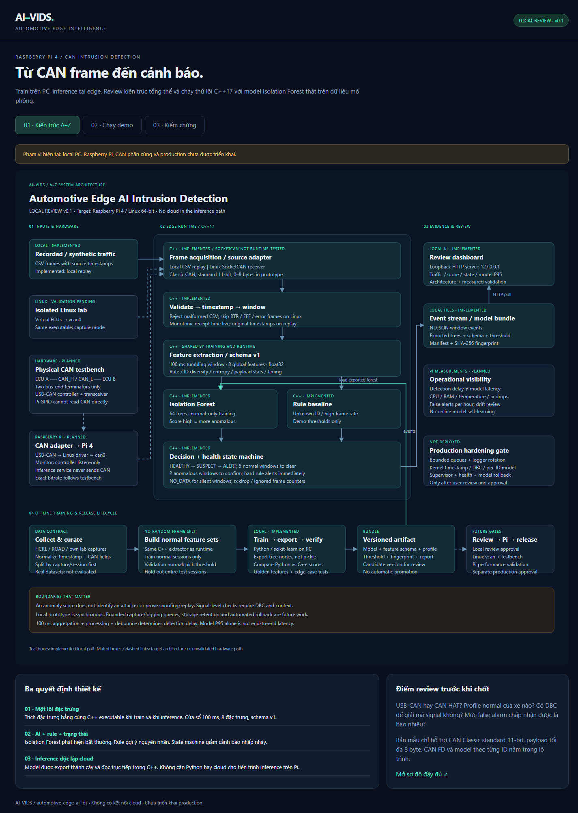
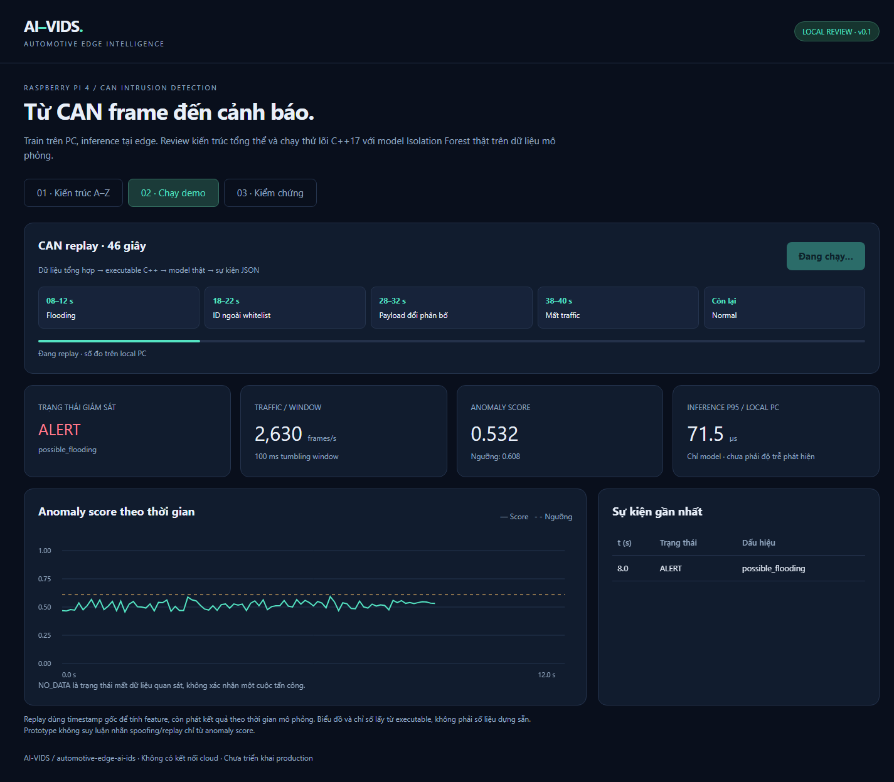

# Kết quả kiểm chứng local

Cập nhật 29/10/2026. Môi trường: Windows AMD64, Python 3.12.0; executable native C++17. Đây là kết quả trên PC hiện tại, **không phải Raspberry Pi**.

## Pipeline và model

- Build C++ native: đạt. Nhánh Linux/AArch64 được cross-compile thành object bằng Zig; chưa link/chạy trên Linux/Pi.
- Unit/integration: **12/12 đạt**, gồm feature tính tay, window boundary, realtime phát sau window end, silence, zero DLC, input lỗi, label leakage và model schema sai.
- Train: 1200 window normal tổng hợp. Validation: 600 window normal độc lập. Normal test: 600 window riêng.
- Python/C++ score parity: **1660 window**, max absolute error **1.11e-16**, tiêu chí ≤1e-7.
- Threshold: **0.608136**, percentile 99.5% trên normal validation; không chỉnh bằng test set.
- ML window FPR trên normal test tổng hợp: **0.67%**. Chỉ 60 giây normal tổng hợp; không suy ra false alerts/giờ trên xe.
- Model fingerprint SHA-256: `500f3d312f046ba718dbb541fcd780f49f390e3cf925eb4148abb69448f94795`.

## Replay qua dashboard

- Browser: Chrome headless / CDP; desktop 1440x1000, viewport nhỏ 390x844.
- Toàn bộ replay: **460 windows / 46 giây mô phỏng**; không lỗi JavaScript, không tràn chiều ngang ở ba tab.
- Model-only P95 ở lượt realtime replay trên local PC: **58.8 µs**. Không bao gồm window accumulation, feature extraction, queue, debounce hay UI; giá trị thay đổi theo máy/tải.

| Kịch bản tổng hợp | Windows | Windows có đúng dấu hiệu | Windows ML vượt ngưỡng | Lý do |
|---|---:|---:|---:|---|
| Flooding | 40 | 40 | 0 | `possible_flooding` |
| Unknown ID | 40 | 40 | 1 | `unknown_id` |
| Payload shift | 40 | 1 | 1 | `ml_anomaly` |
| Silence | 20 | 20 | 0 | `no_frames` |

Cột ML và cột dấu hiệu đo hai thành phần khác nhau. Flooding/unknown ID có thể do rule bắt dù model không vượt ngưỡng. Không dùng kết quả ghép rule+AI để tuyên bố model AI tự nhận diện được tất cả kịch bản. Silence là health event.

**Vấn đề cần review:** ở kịch bản payload shift hiện tại, chỉ 1/40 window vượt threshold; không đủ hai window liên tiếp để tạo confirmed ALERT. Model global-feature này còn yếu với thay đổi payload và không đạt tiêu chí phát hiện bền vững cho kịch bản đó. Cần nghiên cứu feature theo từng ID/signal hoặc model bổ sung bằng dữ liệu đại diện; không hạ threshold dựa trên demo để che hạn chế này.

## Chưa được kiểm chứng

HCRL/ROAD, traffic thật, DBC, spoofing/replay theo ngữ nghĩa signal, SocketCAN runtime, Pi throughput/CPU/RAM/nhiệt, long-run stability, kernel/driver drops, evidence retention và production rollback. Không có deployment lên Pi hay production.

## Tái lập

```powershell
.\.venv\Scripts\python.exe tools/prepare.py
.\.venv\Scripts\python.exe -m unittest discover -s tests -v
.\.venv\Scripts\python.exe tools/serve.py
# Terminal khác, cài requirements-review.txt nếu cần:
.\.venv\Scripts\python.exe tests/browser_smoke.py
.\.venv\Scripts\python.exe tools/report.py
```




