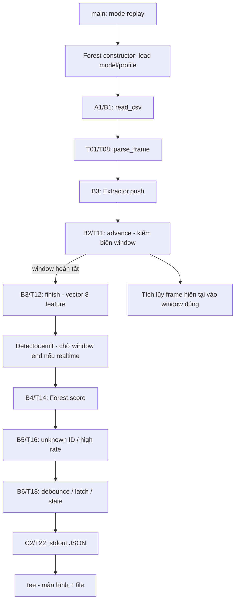

# Ubuntu VM — map task, lệnh, code và output 1:1

Đọc tài liệu này theo đúng thứ tự các lệnh bạn đã được hướng dẫn chạy. Source tham chiếu là bản local đã gửi trong gói Ubuntu VM. Tài liệu không sửa runtime/model và không yêu cầu cài lại môi trường.

## 0. Đoạn log bạn gửi xác nhận điều gì?

File paste có 52 dòng JSON đầy đủ, từ window `[40.8, 40.9)` tới `[45.9, 46.0)` giây; đầu file có một dòng bị cắt. Cả 52 window đầy đủ đều HEALTHY. Chấm lại CSV/model gốc cho 52 timestamp này: cả 52 score khớp trong sai số 1e-9; chênh lệch lớn nhất khoảng 4.67e-11 do số chữ số in ra.

Điều này khớp đoạn cuối replay demo. Paste không chứa output checker/tests/vcan, nên không dùng riêng đoạn này để kết luận các nhánh đó đã được kiểm chứng. Bạn báo đã chạy OK; phần dưới giải thích đúng những lệnh tương ứng, kể cả lệnh không xuất hiện trong paste.

Ví dụ lấy nguyên một event:

```json
{"t_ms":40800,"window_end_ms":40900,"frames":92,"fps":920,"score":0.4615071301,"threshold":0.6081362379,"state":"HEALTHY","reason":"normal","unknown_frames":0,"inference_us":20.126,"rx_drops":0,"ignored_frames":0}
```

**Một dòng là một WINDOW 100 ms, không phải một CAN frame.** Đường replay cập nhật feature cho từng frame nhưng gọi model một lần mỗi window hoàn chỉnh, tương đương 10 lần/giây dữ liệu.

## 1. Những thứ nào thực sự tham gia chạy?

| Thành phần | Cần cho bước nào | Vai trò |
|---|---|---|
| Ubuntu guest và Linux kernel | Tất cả; SocketCAN cần kernel hỗ trợ CAN | Môi trường chạy executable; vcan nằm trong guest |
| CMake, C++ compiler, build tools | Build | Biến source C++ thành binary Linux |
| `CMakeLists.txt`, `src/main.cpp` | Build | Khai báo target và toàn bộ lõi prototype |
| `build/ai-vids` | features/score/replay/capture | Một executable có bốn mode |
| `data/demo.csv` | Replay, một số tests, UI replay | CAN frames tổng hợp, không phải model |
| `models/demo.forest` | Score/replay/capture | Cây đã train, threshold, window/schema và whitelist |
| `vm-bundle.json`, `models/pi-golden-*` | Checker | Kiểm file được copy đúng và score khớp reference |
| Python 3 standard library | Checker/tests/UI server | Orchestration và đọc/ghi; model inference vẫn nằm trong C++ |
| `ip`, `modprobe`, module `vcan` | Chuẩn bị vcan | Tạo network interface CAN ảo trước khi IDS bind |
| `cansend` trong can-utils | Live smoke test | Tiến trình bên ngoài gửi frame vào vcan |
| `tools/serve.py`, `ui/index.html`, browser | UI replay | Chạy subprocess C++, đọc event, vẽ kết quả |
| numpy/scikit-learn trên PC | Training đã thực hiện trước | Fit model rồi export; không chạy lại khi replay trong VM |

Arch là cách chia trách nhiệm. **B1–B6 hiện cùng nằm trong `src/main.cpp`, xử lý đồng bộ trong một luồng C++**. Chưa phải sáu service/thread và chưa có capture queue. Python HTTP server chỉ tham gia khi bạn chạy UI.

## 2. Lệnh chuẩn bị và build — T36 + phần Linux của T07

```bash
sudo apt install -y build-essential cmake python3 can-utils iproute2 kmod
tar -xzf ~/ai-vids-ubuntu-vm-review.tar.gz -C ~/ai-vids-vm
cmake -S . -B build -DCMAKE_BUILD_TYPE=Release
cmake --build build -j2
```

Các lệnh trên được chạy ở vị trí/thứ tự theo guide setup; thư mục giải nén phải tồn tại và lúc gọi CMake bạn đứng trong project.

Luồng:

```text
apt                 → cài công cụ; không chạy AI
tar                 → bung source/data/model đã đóng gói; không train model
cmake -S . -B build  → đọc CMakeLists.txt, tìm compiler, sinh build configuration
cmake --build build → compile src/main.cpp → object → link → build/ai-vids
```

`CMakeLists.txt:3` khai báo `add_executable(ai-vids src/main.cpp)`; dòng 4 yêu cầu C++17. Khi compile trên Linux, `#ifdef __linux__` mở nhánh SocketCAN. Chỉ khi chạy binary thì `main()` mới được gọi.

**Outcome:** binary đúng Ubuntu guest. Build không đọc CSV để học, không tự tạo model mới, không tự bật vcan. Tham số `-j2` là mức song song lúc build, không biến runtime thành hai worker.

## 3. Checker — T36, T14 và phần Linux của T15

```bash
python3 tools/verify_pi_bundle.py --manifest vm-bundle.json
```

| Thứ tự | Code | Làm gì |
|---|---|---|
| 1 | `tools/verify_pi_bundle.py:14` | Parse manifest argument, đọc JSON |
| 2 | Dòng 19 | Tính SHA-256 từng file, đối chiếu hash đã đóng gói |
| 3 | Dòng 24 | Gọi subprocess `build/ai-vids score models/demo.forest models/pi-golden-features.csv` |
| 4 | `src/main.cpp:271` | Mode score: load Forest, đọc từng vector có sẵn, bỏ cột timestamp |
| 5 | `Forest::score`, dòng 169 | Chấm mỗi vector qua 64 cây, stdout một số score mỗi dòng |
| 6 | Python dòng 26–34 | So 32 score với `pi-golden-scores.txt`, yêu cầu max error ≤1e-7 |
| 7 | Python dòng 35 | In JSON PASS cùng OS/architecture thực tế |

Ở mode score, vector đã có sẵn: không đọc raw CAN, không chạy Extractor, không gọi decision/rule. Tên file có “pi” do giữ tương thích bộ gói cũ; checker không ép ARM64.

PASS nghĩa là file khớp bundle và scorer ở nền tảng mới khớp reference. Nó không đo recall, không chứng minh phát hiện mọi tấn công. Golden reference là output C++ local đã được kiểm với sklearn ở bước prepare trước đó. Nếu bạn sửa các file thuộc inventory, checksum đổi là hành vi đúng; lúc đó cần version/bundle mới cho bản đã sửa.

## 4. Tests — mỗi test chạy gì?

```bash
python3 -m unittest discover -s tests -v
```

Python `unittest` tìm các hàm `test_*` trong `tests/test_pipeline.py`. `setUp()` tạo thư mục tạm. Hầu hết test ghi CSV nhỏ rồi dùng `subprocess.run()` gọi binary thật; không mock kết quả C++.

| Test | Task | Code/đầu vào được kiểm | Outcome |
|---|---|---|---|
| `test_golden_features_and_exact_window_boundary` | T11/T12 | Hai payload 00/FF cùng ID, frame thứ ba ở đúng 100 ms; mode features | Feature tính tay đúng, frame biên không lọt window cũ |
| `test_silent_gap_emits_no_data` | T11/T19 | Frame 0 rồi 300 ms; mode replay | Hai window giữa thành NO_DATA |
| `test_label_is_not_used_for_inference` | T01/T08 | Cùng input, đổi label normal thành attack | Output giống nhau sau khi bỏ timing đo |
| `test_malformed_dlc_is_rejected` | T08/T27 | DLC 8 nhưng chỉ có 1 byte | Exit nonzero và lỗi DLC/payload |
| `test_out_of_order_timestamp_is_rejected` | T08/T11/T27 | Timestamp sau nhỏ hơn trước | Bị từ chối |
| `test_negative_timestamp_is_rejected` | T08/T27 | Timestamp âm | Bị từ chối |
| `test_extended_id_is_rejected` | T08/T27 | ID vượt standard 11-bit | Bị từ chối theo scope v1 |
| `test_empty_payload_is_valid` | T08 | DLC 0, payload rỗng | Được đọc hợp lệ |
| `test_wrong_model_schema_is_rejected` | T14/T27 | Model header sai | Forest loader từ chối |
| `test_synthetic_scenarios_have_evidence` | T02/T16/T18 | Replay demo và kiểm các khoảng kịch bản | Đủ 460 windows, có reason cần thấy; kiểm latch khi đủ điều kiện recovery |
| `test_export_parity_report` | T14 | Đọc `runtime/validation.json` | Chỉ kiểm metadata báo cáo offline, không chấm lại 1660 vector trên Ubuntu |
| `test_realtime_replay_waits_until_window_end` | T02/T11 | Replay realtime một window 100 ms | Có window_end_ms=100 và không phát ngay tại t=0 |

12 tests OK là kiểm chức năng trong scope trên. Test scenario yêu cầu xuất hiện dấu hiệu, không đòi model phát hiện tất cả 40 window payload shift. Một assertion recovery chỉ chạy khi các window recovery đều reason normal. Chất lượng detector và độ phủ toàn bộ state machine cần kiểm riêng.

## 5. Replay — đây là đường tạo log bạn gửi

```bash
./build/ai-vids replay data/demo.csv models/demo.forest --realtime \
  | tee runtime/replay-vm.ndjson
```

Ý nghĩa từng argument:

| Argument | Vai trò |
|---|---|
| `./build/ai-vids` | Executable Linux đang chạy |
| `replay` | Chọn nhánh CSV, `main()` dòng 279 |
| `data/demo.csv` | File frame đầu vào |
| `models/demo.forest` | Model/profile đã export |
| `--realtime` | Chờ theo mốc cuối từng window để phát kết quả theo thời gian mô phỏng |
| `tee ...` | Công cụ shell sao chép stdout ra màn hình và file; không tạo score/cảnh báo |



Call chain chính xác:

```text
main() [279]
  ├─ Forest m(model_path) [145]       → giữ model + whitelist + threshold
  ├─ Extractor e(m.whitelist) [45]    → giữ accumulator theo window
  ├─ Detector d(m, realtime) [189]    → giữ bad/good counters và state
  └─ read_csv(path, callback) [122]
       └─ với mỗi dòng: parse_frame(line) [98] → Frame
            └─ e.push(Frame, callback_window) [76]
                 ├─ advance(Frame.us) [66]
                 │    └─ nếu đã hết window:
                 │         finish() [46] → Window{x[8], count, unknown, start}
                 │         d.emit(Window) [190]
                 │           ├─ sleep_until(window_end) nếu realtime
                 │           ├─ m.score(x) [169]
                 │           ├─ rule + state transition
                 │           └─ std::cout JSON [206]
                 │         reset() accumulator [62]
                 └─ tích lũy Frame hiện tại [78]
```

`callback` ở đây là lambda nối hàm trong cùng luồng, không phải message queue. `advance()` chạy trước khi tích lũy frame mới: frame đúng timestamp biên được đưa vào window mới, không cộng vào window vừa đóng.

### 5.1 Parser biến một dòng CSV thành gì?

```csv
0,100,8,546053656B76858B,normal
```

Thành `Frame{us=0, id=0x100, data=[0x54,0x60,0x53,0x65,0x6B,0x76,0x85,0x8B]}`. `100` trong cột ID là HEX, tức decimal 256. DLC=8 cần đúng 16 ký tự hex payload. Label `normal` không được parser dùng để quyết định.

### 5.2 Window 40.8–40.9 giây được tạo ra thế nào?

`advance()` chia theo `WINDOW_US=100000`. Frame có timestamp `40800000 ≤ us < 40900000` thuộc window này. CSV gốc có 92 frame trong khoảng đó; frame kế tiếp qua biên làm `finish()` đóng window rồi chuyển accumulator sang window sau.

Đây là timestamp trong dữ liệu, không phải đồng hồ UTC. `--realtime` điều tiết thời điểm phát output bằng steady_clock; không cam kết hard real-time. Khi không bật flag, feature/score giữ cùng logic, chỉ bỏ chờ realtime. Window cuối thiếu thời gian tại EOF không được tự score; generator có đoạn tiếp theo để đóng đủ 460 window của 46 giây demo.

### 5.3 Vector thực của ví dụ này

Các giá trị dưới đây được tái dựng bằng executable local từ CSV/model gốc, không phải feature có sẵn trong paste của bạn:

| Index | Feature | Giá trị | Code tạo ra |
|---|---|---:|---|
| 0 | fps | 920 | count × 10 = 92/0.1 |
| 1 | unique_ids | 3 | Số key trong counts_ |
| 2 | id_entropy | 1.584791422 | -Σ p(id) log2 p(id) |
| 3 | max_id_share | 0.336956531 | Tỷ trọng ID lớn nhất |
| 4 | byte_mean | 121.0584259 | sum_ / bytes_ |
| 5 | byte_std | 19.05335999 | Population std từ sum_/sq_ |
| 6 | bit_flip_mean | 0.336200833 | Tỷ lệ bit khác trung bình giữa payload cùng ID/cùng DLC |
| 7 | same_id_iat_ms | 3.260887623 | Khoảng thời gian trung bình giữa các frame cùng ID trong window |

`push()` tích lũy số liệu; `finish()` tính vector. Frame trước của mỗi ID reset ở mỗi window. Model nhận float32[8]; không nhận trực tiếp raw payload hoặc nhãn “normal”.

### 5.4 Model tính score như thế nào?

Model header:

```text
AIVIDS_IFOREST_V1 8 64 128 0.6081362379062818 100000 3
256 512 768
```

Tương ứng: schema v1, 8 feature, 64 cây, max_samples 128 khi train, threshold, window 100000 µs, whitelist 3 IDs. Whitelist decimal 256/512/768 tương ứng 0x100/0x200/0x300. `128` không có nghĩa phải gom 128 CAN frame mỗi window.

`Forest::score()` đi từ root xuống leaf trong từng cây: nếu `x[feature] <= split_threshold` đi trái, ngược lại đi phải. Ví dụ ở cây đầu, `same_id_iat_ms=3.260887623 > 2.908064287` nên đi phải; sau đó `byte_std=19.05336 <= 19.17534` nên đi trái. Tiếp tục tới leaf, cộng độ sâu và correction theo số mẫu leaf. Tổng hợp cả 64 cây thành score:

```text
score = 2 ^ (- total_path_length / (tree_count × correction(max_samples)))
```

Kết quả của window ví dụ: `0.4615071301`. Score cao hơn là bất thường hơn; không phải xác suất tấn công 46.15%.

### 5.5 Từ score thành HEALTHY

`Detector::emit()` đánh giá:

```text
unknown_frames = 0                 → không có hard rule unknown ID
fps = 920 ≤ 1800                  → không có hard rule high rate
score = 0.461507 < 0.608136        → model không vượt ngưỡng
abnormal = false                 → reason = normal
bad_ = 0; good_ tăng
state → HEALTHY, hoặc giữ ALERT nếu chưa đủ 5 normal để clear
```

Log cụ thể đã in HEALTHY. Các quy tắc chung còn có: 1 window ML anomaly → SUSPECT, 2 liên tiếp → ALERT; hard rule → ALERT ở cuối window; 5 normal liên tiếp clear ALERT; window rỗng → NO_DATA trong prototype hiện tại.

## 6. Map từng trường JSON về code

Tất cả được in trong `Detector::emit()`, `src/main.cpp:206`.

| JSON | Nguồn trong code | Nghĩa trong log ví dụ |
|---|---|---|
| `t_ms` | w.start / 1000 | Bắt đầu window tại 40.8 s dữ liệu |
| `window_end_ms` | (w.start + WINDOW_US) / 1000 | Kết thúc window tại 40.9 s |
| `frames` | w.count | 92 CAN frame, không phải 92 cuộc tấn công |
| `fps` | w.x[0] | 920 frames/s quy đổi từ window 100 ms |
| `score` | model_.score(w.x) nếu có frame | Anomaly score 0.461507 |
| `threshold` | model_.threshold load từ forest header | Ngưỡng cố định của model bundle |
| `state` | state_ sau state transition | HEALTHY ở window này |
| `reason` | rule/model reason của window hiện tại | normal; có thể khác state khi alarm còn latch |
| `unknown_frames` | Extractor đếm ID ngoài whitelist | 0 frame lạ trong window |
| `inference_us` | steady_clock đo quanh model_.score | 20.126 µs = 0.020126 ms; loại trừ chờ window/features/rule/JSON/UI |
| `rx_drops` | Detector.rx_drops; capture có cập nhật SO_RXQ_OVFL | Replay giữ mặc định 0; không chứng minh CAN vật lý không rơi frame |
| `ignored_frames` | Detector.ignored; capture tăng khi frame ngoài scope | Replay giữ mặc định 0; CSV sai làm parser báo lỗi thay vì tăng counter này |

`normal` là đánh giá của baseline hiện tại trong window, không xác nhận tuyệt đối mạng an toàn. Tất cả output ví dụ được tính từ input/model; không lấy nhãn CSV rồi in lại.

## 7. vcan/capture — T03/T09 dùng nhánh code khác ở đầu vào

```bash
sudo modprobe vcan
sudo ip link add dev vcan0 type vcan
sudo ip link set dev vcan0 up
./build/ai-vids capture vcan0 models/demo.forest
```

Ba lệnh đầu chạy công cụ Linux bên ngoài chương trình: nạp module → tạo interface → đưa interface lên UP. `capture()` không tự làm các việc này.

```text
Terminal B: cansend vcan0 666#1122334455667788
 → cansend gửi raw frame vào kernel vcan của Ubuntu guest
 → Terminal A: main(mode=capture) [282]
 → Forest(model) [145]
 → capture(vcan0, model) [218]
    if_nametoindex → socket(PF_CAN, SOCK_RAW, CAN_RAW)
    → setsockopt(receive buffer, overflow/error subscriptions)
    → bind(interface)
    → poll(timeout 20 ms)
       ├ có frame: recvmsg → kiểm frame/flag → Frame(timestamp(), id, data)
       │          → Extractor.push → finish → Detector.emit → JSON
       └ timeout: Extractor.advance(timestamp()) → có thể emit NO_DATA
```

Mode capture nhận trực tiếp `can_frame`, không đi qua `parse_frame()` CSV. Timestamp hiện lấy từ steady_clock lúc user space nhận frame, tính từ lúc capture khởi động. Phần window/features/model/rule/decision phía sau dùng lại cùng class với replay.

`cansend` là tiến trình phát frame; IDS chỉ đọc. Frame 0x666 ngoài whitelist làm `unknown_frames>0`, hard=true, reason unknown_id và ALERT ở cuối window, kể cả score AI thấp. Kết quả đó là rule detection, không gọi là AI tự phân loại được tấn công.

## 8. UI replay — T20

```bash
python3 tools/serve.py --port 8765
```

Chạy server mới chỉ mở HTTP. Khi bấm Chạy kịch bản:

```text
ui/index.html: play.onclick
 → POST /api/replay
 → Handler.do_POST() [serve.py:79]
 → replay() [19] → Python background worker
 → subprocess.Popen(ai-vids replay demo.csv demo.forest --realtime) [28]
 → C++ stdout JSON từng window
 → Python json.loads → events deque(maxlen=600) + runtime/events.ndjson
 → browser poll GET /api/state mỗi 350 ms
 → update metric/state/table + canvas draw
```

Browser không chạy Isolation Forest. Python không train lại model khi bấm Play. C++ vẫn làm tính toán như lệnh replay terminal. Terminal capture chạy riêng không tự cập nhật server này: việc nối live UI là T21, chưa có implementation. Tab validation đọc metadata PC đã đóng gói; không tự biến thành báo cáo VM. Một số nhãn UI hiện còn ghi cố định “local PC”; chúng không tự nhận diện host. Khi server/subprocess chạy trong guest thì timing mới của lượt replay thuộc guest, cần đọc kèm metadata môi trường thay vì chỉ dựa nhãn UI.

## 9. Model/CSV từ đâu mà có nếu Ubuntu không train?

Trước lúc đóng gói, trên PC đã chạy `tools/prepare.py`:

```text
generate() [33] → normal train/validation/test + demo CSV
 → extract() [61] → gọi C++ mode features [main.cpp:264]
 → load vectors float32 → IsolationForest.fit(normal_train) [prepare.py:81]
 → threshold = quantile(-score_samples(normal_validation), 0.995) [84]
 → export nodes/header/whitelist thành models/demo.forest [86]
 → so C++ score với sklearn trên 1660 windows [96]
 → manifest.json + validation.json [119]
 → package_pi.py --target ubuntu-vm → archive source/model/data cho VM
```

Training cần numpy/sklearn trên PC; inference VM đọc artifact đã tạo. Label chỉ phục vụ mô tả/đánh giá; không được đưa vào feature. Isolation Forest là anomaly detector, không phải classifier gán nhãn DoS/replay/spoofing.

## 10. Bảng tra đầy đủ T01–T38 → code hiện có

Đây là index để khỏi tìm lan man; một hàm có thể thực hiện nhiều trách nhiệm arch. “Chưa có” được giữ rõ, không gán nhầm task thiết kế vào code demo hiện tại.

| Task | Code/command tương ứng | Phạm vi thực tế |
|---|---|---|
| T01 | parse_frame, main.cpp:98 | CSV contract v1 |
| T02 | prepare.generate:33; main.cpp:279 | CSV sinh trước trên PC; replay trong VM |
| T03 | modprobe/ip link | Kernel/interface setup, bên ngoài C++ |
| T04 | Chưa có harness tự động | Gửi tay cansend là smoke test, chưa thay được scenario harness |
| T05 | Không phải code runtime | Adapter/BOM/wiring cần chốt phần cứng |
| T06 | capture can0, main.cpp:218 | Chưa suy ra đạt vật lý từ vcan/replay |
| T07 | CMakeLists.txt:3; native compiler | Build VM kiểm phần Linux, chưa build/run Pi |
| T08 | parse_frame/read_csv:98/122 | Chuẩn hóa CSV, kiểm lỗi |
| T09 | capture:218 | Receiver SocketCAN, chỉ chạy ở mode capture |
| T10 | timestamp lambda:235 | Hiện user-space monotonic receipt time, chưa kernel timestamp mapping |
| T11 | Extractor.advance/reset:66/62 | Window boundary, gap, reset |
| T12 | Extractor.push/finish:76/46 | 8 feature dùng chung train/runtime |
| T13 | Chưa có per-ID/signal schema v2 | Chưa cải thiện payload miss bằng feature mới |
| T14 | Forest constructor/score:145/169 | Load cây và tính anomaly score |
| T15 | verify_pi_bundle.py:14 | VM xác nhận chuyển sang Linux; Pi ARM64 cần lần chạy riêng |
| T16 | Detector.emit:195 | Unknown ID/rate rules demo |
| T17 | Forest.whitelist:153 và rate 1800:195 | Mới profile toy, chưa profile mạng lab/DBC |
| T18 | Detector.emit:198 | Debounce, latch, clear state |
| T19 | Detector.emit:198; capture counters | Có NO_DATA; health/alarm vẫn chung một state |
| T20 | serve.replay:19; UI play/poll/draw | Replay UI orchestration |
| T21 | Chưa có live source cho server/UI | Capture terminal chưa đi vào dashboard |
| T22 | Detector.emit JSON:206 | Chỉ window events, chưa alert opened/closed/context đầy đủ |
| T23 | Chưa có evidence ring buffer/rotation | tee và NDJSON file không thay thế evidence retention |
| T24 | report.py + docs/VALIDATION.vi.md | Báo cáo synthetic trước đó; chưa quality trên dữ liệu thực |
| T25 | inference_us ở emit:193 | Chỉ model time từng window; chưa full Pi benchmark |
| T26 | Chưa có queues/async C++ logger | Capture/features/score/stdout đang đồng bộ |
| T27 | tests/test_pipeline.py:60 | Các negative tests local; chưa đủ interface/disk/queue/restart faults |
| T28 | Chưa đưa dataset thực vào pipeline | Link nguồn dữ liệu không đồng nghĩa đã train dữ liệu đó |
| T29 | Chưa có converter HCRL/ROAD/lab | Parser CSV demo không thay toàn bộ dataset adapter |
| T30 | prepare.py:75 | Chỉ phiên/seed synthetic riêng; real split/audit leakage chưa có |
| T31 | C++ mode features:264; prepare.extract:61 | Có extractor chung; data lineage thực chưa hoàn chỉnh |
| T32 | IsolationForest.fit, prepare.py:81 | Train normal-only trên PC |
| T33 | quantile threshold, prepare.py:84 | Calibration normal validation demo |
| T34 | Scenario test/report + failure analysis | Payload shift 1/40 ML window, chưa đạt confirmed alert |
| T35 | forest header + manifest, prepare.py:86/119 | Demo metadata có; production provenance/enforcement còn thiếu |
| T36 | package_pi.py:13; verifier:14 | Đóng gói/hash/cross-platform golden scores |
| T37 | Guide/checklist, chưa runtime mới | VM là bước trước Pi staging |
| T38 | Chưa có installer/systemd/rollback | Chưa triển khai production |

## 11. Cách tự nhìn dữ liệu trung gian bằng đúng executable

Không cần train lại hoặc sửa code:

```bash
# Raw CAN CSV → vector theo window:
./build/ai-vids features data/demo.csv runtime/inspect-features.csv

# Vector có sẵn → score AI, không rule/state:
./build/ai-vids score models/demo.forest runtime/inspect-features.csv

# Raw CSV → feature → AI + rule + state → JSON:
./build/ai-vids replay data/demo.csv models/demo.forest
```

Đọc log ví dụ theo chuỗi: **92 frame → vector 8 chiều → 64 cây → score 0.4615 → rule không kích hoạt → state HEALTHY → một dòng JSON**. Các trường timing/drop phải đọc đúng mode tạo ra chúng.
